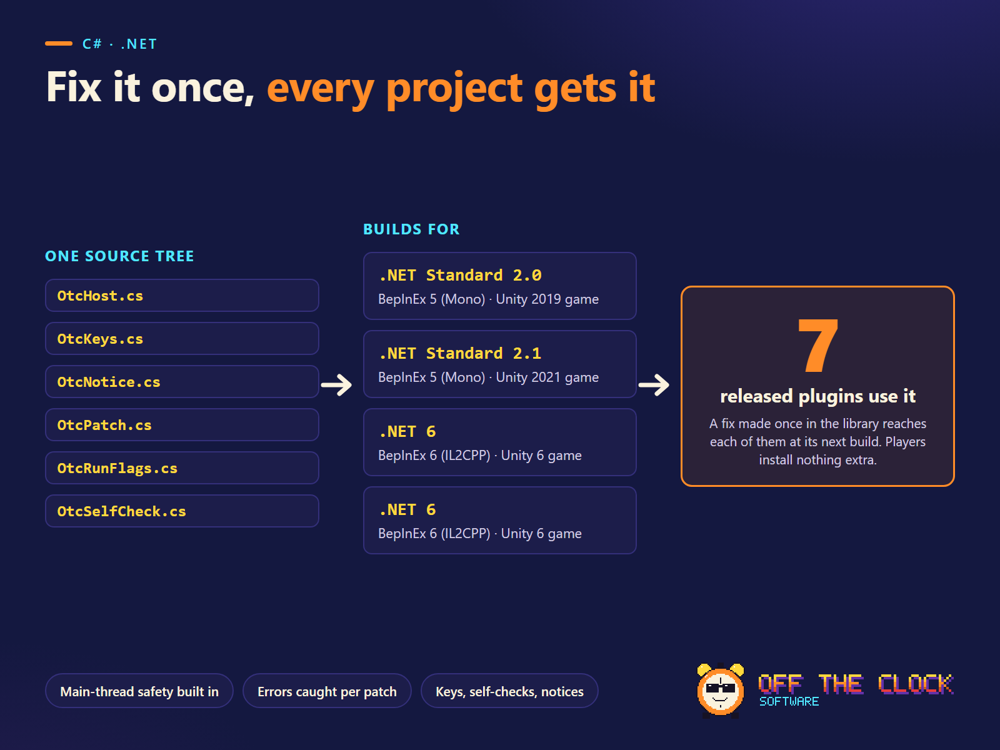

# otc-bepinex

**Crash-safe building blocks for BepInEx plugins: one C# source tree, compiled into each plugin, for BepInEx 5 (Mono) and BepInEx 6 (IL2CPP).**



**What it does for a plugin**
- **A game update never crashes it.** Each Harmony patch is applied on its own. A missing class or method skips only that feature, with one WARNING line. If a *required* part is missing, the plugin undoes its own patches and does nothing, instead of half its job.
- **Exceptions stay inside the plugin.** Every patch body and per-frame callback is guarded. The first 3 errors per call site are logged (the first with a stack trace), then it goes quiet. On IL2CPP, where an exception leaving a patch is silently swallowed, this is the difference between a clear log line and a mystery.
- **Hotkeys that behave:** configurable, one action per key-down, no repeat while held, no firing while the player types in chat, keys switch themselves off with one WARNING if input breaks.
- **Test sessions that grade themselves.** The plugin writes `[SELFCHECK] <Mod> <check> PASS/FAIL/WAITING` lines from values it read back from the game.
- **Above board by design.** `OtcRunFlag` sets the game's own "cheated/modded run" flag before a run is changed and has no API to clear it. `OtcOnline` answers "is another player's game involved?" and fails safe to "yes".

**Proof:** 20 offline tests (stub Unity/BepInEx/Harmony types, no game needed) run on every push. In our own work the same sources compile against the real references of four games (two BepInEx 5 Mono, two BepInEx 6 IL2CPP) and ship in 7 released plugins.

## Quick start

1. Copy or submodule this repository next to your plugin, for example `lib/otc-bepinex/`.
2. In your plugin's `.csproj` (or a `Directory.Build.props`):
   ```xml
   <PropertyGroup>
     <OtcRuntime>IL2CPP</OtcRuntime>   <!-- Mono (BepInEx 5) or IL2CPP (BepInEx 6). Inferred from TargetFramework if left out. -->
     <OtcNotice>false</OtcNotice>      <!-- optional: leave out the on-screen notice (no UnityEngine.IMGUIModule ref) -->
     <OtcKeys>false</OtcKeys>          <!-- optional: leave out hotkeys (no UnityEngine.InputLegacyModule ref) -->
   </PropertyGroup>
   <Import Project="lib\otc-bepinex\OtcBepInEx.props" />
   ```
3. Reference your game's DLLs as usual: BepInEx (5: `BepInEx.dll`; 6: `BepInEx.Core`, `BepInEx.Unity.IL2CPP`, `Il2CppInterop.Runtime`), `0Harmony`, `UnityEngine.CoreModule`, plus `UnityEngine.InputLegacyModule` for keys and `UnityEngine.IMGUIModule` + `UnityEngine.TextRenderingModule` for the notice.

Players install nothing extra. The `.cs` files are compiled **into** your plugin; every type is `internal` (namespace `OffTheClock.Lib`), so two plugins using different versions of the library never clash.

## Example

```csharp
using OffTheClock.Lib;

public override void Load()                        // BepInEx 6 IL2CPP (BepInEx 5: void Awake() with Logger)
{
    const string Id = "MyMod";                     // one word: log prefix and self-check id
    OneKey = Config.Bind("Controls", "LevelUpKey", KeyCode.KeypadDivide, "Key that gives you one level during a run.");

    OtcPatch.Init(Log, Id);                        // guarded errors: first 3 per site, then quiet
    SC = new OtcSelfCheck(Log, Id);
    SC.Expect("level_given", "start a run and press Numpad /");

    var p = new OtcPatcher(new Harmony(PluginInfo.PLUGIN_GUID), Log, Id, SC);
    p.Class(typeof(RunGuard), required: true, feature: "cheated-run guard");
    p.Class(typeof(LevelUpGuard), feature: "level-up screen guard");                  // optional
    p.Method("co-op count", typeof(CharacterController), "UpdateMaxWeaponCount", Type.EmptyTypes,
             typeof(Patches), postfix: nameof(Patches.AfterCoopCount), declaredOnly: true);
    if (!p.Finish()) return;                       // a required part is missing: UnpatchSelf, self-checks FAIL, do nothing

    OtcHost.Start(this, Log, Id);                  // per-frame driver on Unity's main thread
    var keys = new OtcKeys(Log, Id) { CanAct = IsPlaying, OnBlocked = _ => Log.LogInfo("press it during a run") };
    keys.Add("one level", OneKey, () => Give(1), cooldown: 0.25f);
    keys.Start();                                  // logs "MyMod: keys - Numpad / = one level."
}
```

A complete compile-ready plugin that uses every part is in [`samples/SamplePlugin.cs`](samples/SamplePlugin.cs).

## What's in it

| Type | What it does |
|---|---|
| `OtcHost` | `Start(plugin, log, id)`, `OnUpdate(name, Action)`, `OnGui(name, Action)`, `Remove(name)`. Runs callbacks from a MonoBehaviour on Unity's main thread; each callback has its own try/catch and is dropped with one WARNING after 3 errors. |
| `OtcKeys` | `Add(name, ConfigEntry<KeyCode> or ConfigEntry<string>, Action, cooldown)`, `Start()`, `Tick()`, `LogActive()`, `IsTyping`, `CanAct`/`OnBlocked`, `KeyName`, `ParseKey`, `MoveOldDefault`. Edge detection on `Input.GetKey`: one action per key-down, holding doesn't repeat, a key held at start or while typing never fires, rebinding re-arms. |
| `OtcPatcher` | `Class(type, required, feature)`, `Method(feature, Type or "Full.Name", method, args, patchClass, prefix/postfix/finalizer, required, declaredOnly)`, `Try(feature, Action, required)`, `Finish()`. One INFO line per applied step, one WARNING per skipped optional part, ERROR + `UnpatchSelf()` when a required part is missing. |
| `OtcPatch` | `Guard(Action)`, `Guard<T>(Func<T>, site, fallback)`, `Report(ex, site)`, `Prefix(__runOriginal, Func<bool>)`. Throttled logging per call site (default site name: `File.Member:line`). |
| `OtcSelfCheck` | `Expect(id, how, optional, grace)`, `Want`, `State`, `Pass`, `Fail`, `Check`, `Wait`, `FailOpen`. Writes `[SELFCHECK]` lines. Line-for-line identical to `otc_selfcheck.lua` from our ue4ss-mod-test-kit repository (copy in `tests/lua/`; a test proves it). |
| `OtcNotice` | `Show(text)`, `Start()`. A small IMGUI box for 2.5 s after a key press, with a config switch; switches itself off on the first drawing error. |
| `OtcRunFlag` | `Mark(reason)`, `IsMarked`, `TimesMarked`. Idempotent, verified by read-back; `false` means "leave the run unchanged". There is deliberately no clear/unmark API. |
| `OtcOnline` | `Configure(log, id, Func<bool>, what)`, `IsOnline`. If the game's check throws, the answer is "online" (the safe side), with one WARNING. |

**Patch bodies with `ref`/`out` parameters** (`ref __result`) can't use lambdas. Write them as
`try { ... } catch (Exception ex) { OtcPatch.Report(ex, "gold prefix"); }` (this form also allocates nothing on hot paths).

## Rules the library is built on

Full checklist with sources: [`docs/ENGINE-BEST-PRACTICES-BEPINEX.md`](docs/ENGINE-BEST-PRACTICES-BEPINEX.md).

1. **Main thread only.** Game and Unity work happens in Harmony patch bodies or `OtcHost` callbacks. No `Task.Run`, threads, timers or `async void`. Nothing in this library starts a thread.
2. **try/catch in every patch body.** IL2CPP swallows an exception that leaves a patch and hands the game 0/null/false.
3. **One feature per patch step**, required parts first.
4. **HarmonyX runs every prefix.** A prefix that skips the original checks `__runOriginal` (`OtcPatch.Prefix`).
5. **Stable GUID and plain `MAJOR.MINOR.PATCH` version**, or BepInEx skips the plugin. Harmony ID = GUID; undo with `UnpatchSelf()`, never `UnpatchAll()`.
6. **Keys configurable**, with defaults checked against the game's own bindings and popular mods.
7. **Never change another player's game, never clear a cheated flag.**

## How the per-plugin host works

`OtcBepInEx.props` defines `OTC_MONO` or `OTC_IL2CPP` (plus `OTC_KEYS`, `OTC_NOTICE`), links `src/*.cs`, and generates `obj/.../OtcHost.g.cs` with a MonoBehaviour named `OtcGenerated.<AssemblyName>.OtcHostBehaviour`. The name is unique per plugin on purpose: Il2CppInterop's `ClassInjector` throws "Type with FullName ... is already injected" for a second injected type with the same full name, so one shared class name would break the second plugin in the same game. `OtcGenerateHost=false` turns generation off; then write your own behaviour and call `OtcHost.Attach<T>(this)`.

The props file also sets a `PathMap` for the library folder, so your local folder names never end up inside the shipped DLL.

## Run flags in real games

Examples of the game's own flags that keep a changed run off leaderboards (found in each game's code):

| Game | Flag | Effect |
|---|---|---|
| BALL x PIT | `BattleSaveData.Cheated` (per run) | The game skips the leaderboard post |
| Vampire Survivors | `PlayerOptionsData.CheatCodeUsed` (save) | The game's own "cheat code used" mark |
| Risk of Rain 2 | `RoR2Application.isModded`, `Console.sessionCheatsEnabled`, plus a null leaderboard name for weekly runs | Modded lobby tag; no Prismatic Trials submit |
| Subnautica | none needed (no leaderboards). Don't use `GameModeUtils` cheats or `DevConsole`: they disable achievements | - |

## Tests

Offline, no game and no NuGet packages: the library is compiled for the Mono target against small stand-in types in `tests/Stubs/`.

```
dotnet run -c Release --project tests
```

Needs the .NET 8 SDK. Expect `20 passed, 0 failed`. The self-check parity test also needs Lua 5.4 on PATH (`lua`, `lua5.4` or `lua54`); without it that test is skipped with a note (CI sets `OTC_REQUIRE_LUA=1`, so there it must run).

## Layout

```
OtcBepInEx.props   import this from your plugin project
src/               the library (6 files)
samples/           SamplePlugin.cs: every part used from a real plugin class (compile-only)
tests/             offline test runner, stub types, Lua parity check
docs/              BepInEx best-practice checklist with sources
```

## License

MIT. See [LICENSE](LICENSE). Use it in free or paid plugins; a credit line is appreciated, not required.

Made by **Off the Clock Software**. Questions and bug reports: open an issue.
